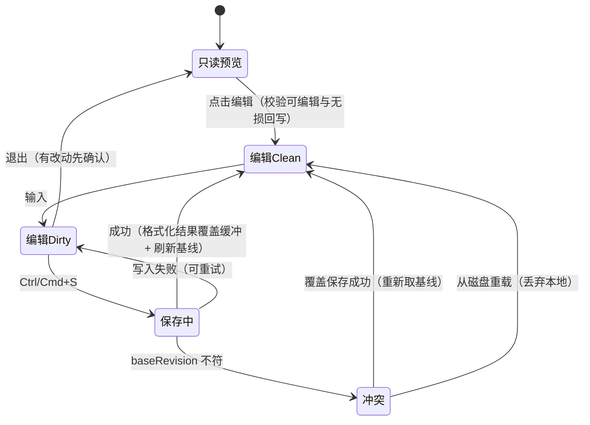
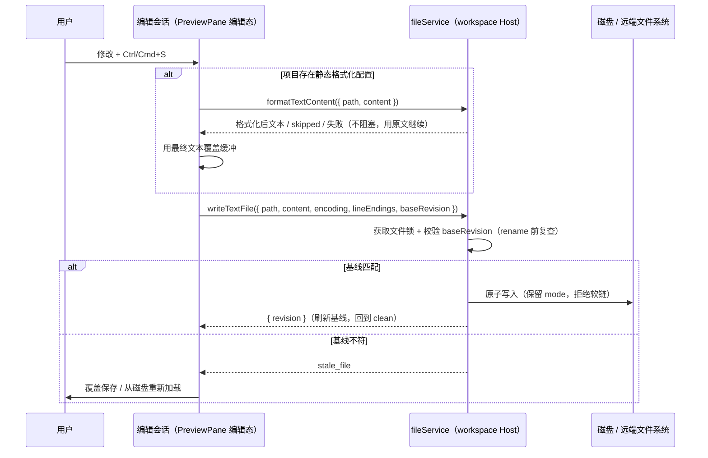
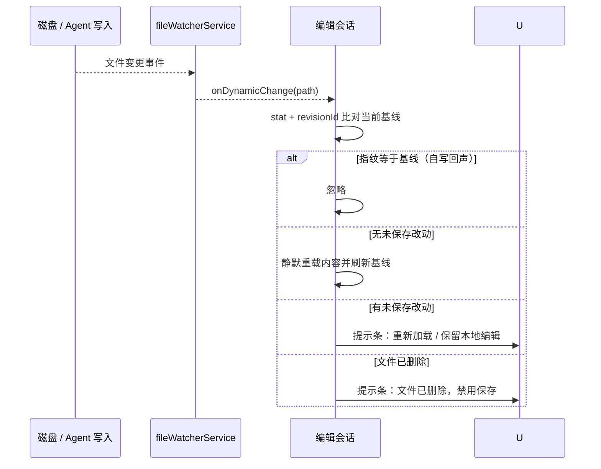
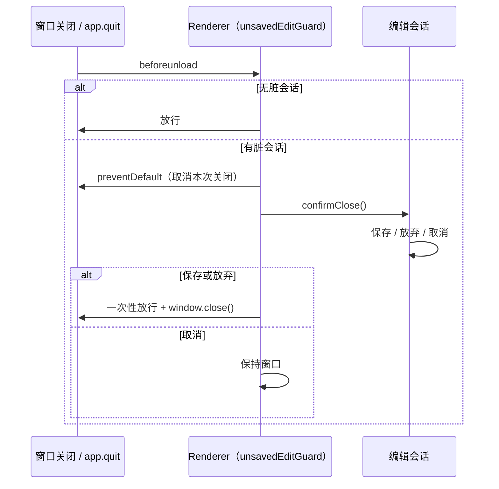

# 文件预览的就地编辑（Monaco，无 LSP）

## 背景与目标

Preview Pane 目前是纯只读查看器（读取链路见 `packages/ui/src/PreviewPane.tsx`），修改文件的唯一路径是经 Open 菜单交给外部应用（`docs/file-preview-open-apps.md`）。本 spec 为桌面端增加文本文件的就地编辑能力：引入 Monaco Editor 作为编辑态引擎，保存经 workspace Host 写回，保存时按项目配置格式化；**一期不接语言服务（LSP）**，补全仅保留 Monaco 内建词法建议。

参考形态来自两个先例：只读与可编辑是"同一引擎 + readOnly 选项"而非两套编辑器（Theia）；保存携带版本凭证、不符时弹冲突确认（Theia 的 etag / OpenBitFun 的 mtime+size 基线 + Host 侧乐观锁）。ZCode 与两者的差异：Agent 本身是并发写文件的一方，用户编辑期间 Agent 改写同一文件是高频场景而非边缘 case，冲突防护必须是一等功能。

本期确定的边界（review 后收敛）：

- **无损回写**：能进入编辑态的文件，必须保证"解码 → 编码"字节级往返一致；编码、换行、BOM 全部按基线还原，不能因为保存而改写用户的换行风格或字符编码。
- **版本契约唯一**：基线使用 `packages/shared` 的单一 `FileRevision`（`id + mtimeMs + sizeBytes + hash`），与 CLI `FileSystemRevision` 同构，不另造 `${mtimeMs}:${size}` 影子格式。
- **Prettier 内置固定版本**：由 Host 依赖固定版本的 Prettier，只读项目静态配置；不解析 workspace 已安装的 Prettier，避免远端无 `node_modules` 时能力失效。
- **关窗口 / 应用退出纳入一期**：未保存改动必须覆盖切文件、关预览、退出编辑、关闭窗口、退出应用五条路径。
- **SVG 源码视图可编辑**：SVG 与 markdown 一致——渲染态只读，切到源码视图后可编辑。

明确不做（一期范围外）：

- LSP / 语义补全 / 诊断标记 / 跳转定义 / hover 文档；编辑器内不得出现暗示语义能力的 UI。
- 手机 Web 与普通 Web 的编辑能力，两端维持只读预览现状。
- 二进制、图片、PDF、Office 文件的编辑；Work 产物版本的就地修改（产物版本仍只读，沿用另存为）。
- 多文件同时编辑（tab 化编辑器）；本 spec 只做单文件编辑会话。
- 执行项目里的可执行格式化配置（`prettier.config.js/.cjs/.mjs/.ts`），只读静态配置（安全边界，见"格式化"）。
- 页面 reload（`Cmd/Ctrl+R`）时的三选一保存：仅用 `beforeunload` 阻断并提示先保存，不承诺在 unload 期间完成 Host 写回。

## 用户行为

### 入口与可编辑判定

- 能力可见性由平台能力开关决定：`IPlatformService` 新增 `canEditTextFiles?: boolean`，仅桌面实现返回 true；手机 Web / 普通 Web 为 undefined，预览头部不渲染编辑入口，行为与现状完全一致。该字段表达"当前客户端带编辑器 bundle"，不是文件系统能力。
- 可编辑判定以 `source.type === "file"` 为准，并排除：
  - 非文件源：`text`（工具输出/消息内联内容，可能带 path 但内容不是从磁盘读来的）、`patch`、`multi-file-diff`、`code-review`；
  - `image` / `media` / `pdf` / `pptx`，以及扩展名判定为 Office 的文件；
  - markdown / SVG 的**渲染视图**（源码视图可编辑，复用现有视图切换菜单）；
  - Work 产物由 `WorkflowArtifactSidePane` 独立渲染，不进入 PreviewPane 编辑链路。
- 文本层校验（任一不满足即把入口渲染为禁用态，hover/无障碍名说明原因，不隐藏——隐藏会让用户以为功能缺失）：
  - Host 判定二进制（`readTextFile` 返回 `isBinary`）→ `binary`；
  - 文件超过 `FILE_TEXT_MAX_BYTES`（256KB，定义在 `packages/shared`，renderer 的 `FILE_VIEWER_MAX_TEXT_BYTES` 与 Host 的 `MAX_TEXT_READ_BYTES` 都引用它，避免三方各自写死而错位），或返回 `truncated` → `too-large`；
  - **无法无损回写**：编辑快照的 `encode(decode(bytes))` 与原始字节不一致 → `not-lossless`；检测到混合换行 → `mixed-line-endings`（见下）；
  - 本次读取未覆盖全文（`offset !== 0` 的分段读取）→ `partial-read`。这不是 Host 能力问题，必须与 `host-unsupported` 区分，否则 UI 会显示"服务端版本过低"的误导提示；
  - 旧远端 Host 不返回 `FileTextSlice.editCapability` / `revision`（这两个字段是可选的），按 `host-unsupported` 处理，不需要额外的版本握手。
  - markdown / SVG 处于渲染视图时不渲染任何编辑入口（禁用态也不显示）：切到源码视图即可编辑，显示"不可编辑原因"反而误导。
- 远程 workspace（SSH / WSL / Docker）与本地同等可编辑：读写都经 workspace-scoped `fileService` 走 Host 通道。与 `file-preview-open-apps.md` 的"远端路径不交给本机 App"不冲突——编辑发生在 ZCode 内部，不调用本机应用。

### 无损回写的判定与实现

- 新增只读入口 `readTextEditSnapshot({ path })`，与预览读取分开：预览继续用 UTF-8 解码，不改变现状；编辑快照额外返回编码、换行与版本（BOM 由往返校验覆盖，不单列字段），内容统一归一化为 LF。
- 预览的 `readTextFile` 直接用同一份 buffer 计算 `editCapability` / `encoding` / `lineEndings` / `revision` 并随 `FileTextSlice` 返回，避免为了显示编辑入口再读一次文件；二进制与 `truncated` 分别给出 `binary` / `too-large`。
- 解码顺序：先用严格 UTF-8（`TextDecoder("utf-8", { fatal: true, ignoreBOM: true })`）解码；`ignoreBOM: true` 让 `U+FEFF` 留在文本里参与往返校验，否则 BOM 会先被吞掉而被误判成 GBK。失败后按 `gb2312` / `gbk` / `gb18030` 依次尝试（与 CLI `FileSystemTextEncoding` 一致）；仍失败即为不可编辑。
- 无损校验：用解码得到的编码重新编码，字节与原文完全一致才允许编辑。该规则同时覆盖 BOM（Node 的 UTF-8 解码保留 `U+FEFF`）、全角/中文字符与尾随换行。
- 换行：检测 `LF` / `CRLF`。混合换行视为不可无损编辑，不提供入口——保存必然统一换行，会制造全文件 diff。空文件与不含换行的单行文件没有可继承的风格，基线取 `LF`，避免首次保存在 macOS/Linux 上写出 CRLF。
- 空文件（0 字节）同样可编辑：`readTextFile` 的空内容分支也要返回 `editCapability` / `encoding` / `lineEndings` / `revision`，否则新建空文件没有编辑入口。
- 保存时按快照记录的原编码与换行写回；编辑器内部统一使用 LF，保存前再执行一次换行还原，保证结果与基线风格一致。

### 编辑态与渲染策略

- 只读预览态维持现有 shiki 渲染，**Monaco 仅在进入编辑态时动态加载**：编辑是用户显式进入的临时态，退出即卸载。理由：`packages/ui` 为桌面与 Web 共用源码，默认预览态高频出现，不应让所有平台为编辑能力付出 Monaco 的加载成本。
- Web / 手机构建会与桌面共用同一份 `packages/ui` 源码，动态 `import()` 会让 Web 产物中**存在但不加载**该 chunk。一期接受这一产物成本；若后续要求产物中也不出现，再由 `packages/web` 构建期 alias 到 stub（不属本期必需）。文档与验收按"不加载"表述，不再声称"bundle 不包含"。
- Monaco 只注册需要的少量 language definitions，**不导入 `monaco-editor` 的 `index.js`**（0.57 起该入口内置 LSP client，与本 spec 的"无 LSP"边界冲突）；使用 `editor/editor.api` + 语言 `register` 子路径，worker 通过 Vite 的 `?worker` 入口打包为独立 chunk。`packages/ui/vite/pdfJsCMapsPlugin.ts` 只是资产产出的先例，不是 worker 先例。
- 主题：读取页面实际生效的 `background` / `foreground` 与 `--font-mono` 生成浅色与深色两套 Monaco theme，其余色值沿用 DESIGN 的中性色；不新增编辑器设置项，也不尝试把 shiki 主题名映射为 Monaco 主题。
- 两套渲染并存、高亮风格可能不一致，一期接受（编辑态是显式动作，非默认体验）。
- Monaco 的 `readOnly` 选项用于编辑会话内部状态：保存进行中、冲突待决策时临时锁定输入；不用于表达"该文件不可编辑"（那由入口判定承担，不可编辑文件根本不加载 Monaco）。
- dirty 状态在预览头部明确标识；`Ctrl/Cmd+S` 保存；无 dirty 时快捷键无操作。
- 带未保存改动时切换文件、关闭预览、退出编辑态，先弹确认：保存 / 放弃 / 取消（取消留在编辑态）。

### 未保存保护（关窗口 / 应用退出）

- 编辑会话是组件局部状态，但关窗必须能查询"是否存在脏会话"。新增 renderer 侧 `unsavedEditGuard`（`packages/ui/src/preview-pane/unsavedEditGuard.ts`）：编辑会话注册 `isDirty()` / `confirmClose()` / `focus()`，退出或卸载时注销；它只做聚合查询，不持有编辑缓冲，不进入全局业务 store。注册表 key 为 `path + sessionId`（不是单独的 path）：同一文件可能在多个 tab 中各自持有会话，用 path 做 key 会让后注册的会话顶掉前一个，前一个的脏改动就无人确认。
- 对外暴露两个入口：`confirmAllUnsavedSessions()`（异步三选一确认）与 `hasUnsavedEdits()`（同步脏检查，供无法 await 的调用点先判断是否需要进入确认流程）。
- 窗口关闭 / 应用退出：dirty 时由 `beforeunload` 取消本次关闭（`preventDefault()` + 非空 `returnValue`，Electron 会静默取消），随后弹出与"退出编辑"相同的三选一确认；保存或放弃后设置一次性放行标记并重新 `window.close()`，取消则保持窗口。该路径同时覆盖 `Alt+F4`、macOS 关闭按钮与 `app.quit()`，不需要新增 main/preload IPC。
- 多窗口 / 多会话：每个窗口的 renderer 各自聚合本窗口会话，`confirmAllUnsavedSessions()` 依次确认，任一取消即中止；同一时刻只有一个确认在进行，避免重复弹框。
- **拦截点必须收口在状态写入处，而不是各个 UI 入口**：能改变 PreviewPane 的 `source`、或卸载 `file-manager` / `code-viewer` tab 的路径有二十多条（聊天里的文件链接、各工具卡片、命令面板、代码评论卡片、`OpenSplitButton`，以及 Agent 产物完成后的**零交互自动打开**）。逐个 UI 入口加确认必然漏，因此统一收口在 `useAppPanels` 的四个状态写入点，各自先 `await confirmAllUnsavedSessions()`，取消则不提交状态：
  - `handleOpenCodeViewer` / `handleOpenCodeViewers`（`openCodeViewerSidePane(s)` 会按 sourceKey 复用已有 tab 并整体替换其 source）；
  - `handleNavigateFileManager`（文件树导航；`FileManagerPane.navigate` 不再自己确认，否则同一次导航会弹两遍框）；
  - `handleCloseCodeViewer`（不得绕过统一关闭入口）；
  - 工作区切换的 effect：整体替换 tabs 会卸载编辑会话，先用 `hasUnsavedEdits()` 同步判断，有脏会话再异步确认；用户取消时**不前移 memory key**，以便再次切换时重试。
- 关闭预览：关闭 `file-manager` / `code-viewer` tab 会卸载其中的编辑会话，因此在 `useAppPanels` 的统一关闭入口 `closeSelectedSidePaneTabs`（单 tab、关闭其他、关闭全部都走这里）先 `await confirmAllUnsavedSessions()`，取消则中止关闭。
- 编辑态用"正在编辑的 path"（`editSessionPath`）而不是 boolean 表示：`source` 对象引用变化但 path 未变时（上游 store 重建 source）不得销毁编辑会话。PreviewPane 的兜底 effect 只在 `editSessionPath !== source.path` 时退出编辑态，且若此时仍是 dirty，记 `logger.error` 留下证据——将来新增绕过拦截的入口时不至于静默丢改动且无从排查。
- markdown / SVG 在编辑态下切回渲染视图：视图切换菜单先 `await confirmAllUnsavedSessions()`，取消则不写入 viewMode（受控 RadioGroup 自动回到原选项）；兜底 effect 同样在 dirty 时记 warn。
- Windows "收进托盘"只是隐藏窗口、编辑会话仍在，不触发 `beforeunload`；只有真正销毁窗口或退出应用时才确认。
- 页面 reload 同样被 `beforeunload` 阻断；reload 期间不承诺完成 Host 写回，只提示先保存。
- 该实现不新增 `IPlatformService` 关窗方法，编辑能力仍只由 `canEditTextFiles` 表达。

### 保存、冲突与外部修改

- 磁盘基线：进入编辑态时 `readTextEditSnapshot` 返回 `FileRevision`（`id`、`mtimeMs`、`sizeBytes`、`hash`）。`id` 格式与 CLI `FileSystemRevision` 一致：`mtime:<trunc mtimeMs>:size:<sizeBytes>`；`hash` 为完整字节的 `sha256:<hex>`。文件受 256KB 上限约束，计算哈希成本可忽略，可避免 mtime 精度不足导致的漏检。
- 保存流程：可选格式化 → `writeTextFile({ path, content, encoding, lineEndings, baseRevision })` → 成功返回新 `FileRevision` 并回到 clean。Host 侧在文件锁内校验基线，`rename` 前再复查一次；不符返回结构化冲突错误，UI 弹"覆盖保存 / 从磁盘重新加载"。
- 冲突判定以 `hash` 为准：mtime 变化但内容字节相同不视为冲突，避免外部工具"原样重写"制造假冲突。
- 覆盖保存：重新 `readTextEditSnapshot` 取最新版本，再带新基线写入；若期间又被改写则再次冲突，不提供"无条件直写"。跨进程（Agent 直接写文件）无法彻底消除竞态，用锁内校验 + rename 前复查把窗口缩到最小。
- 打开期间的被动感知：复用 `fileWatcherService.watch / onDynamicChange`（PreviewPane 已有 pptx 文件监听先例）。收到目标文件变更事件时读取编辑快照，以**内容哈希**与当前基线比对：
  - 哈希等于当前基线：视为自写回声（刚刚保存成功），忽略，不重载、不提示。判定必须用哈希而不是 `mtime + size`——外部工具保留 mtime 改写同尺寸内容时，mtime 比对会把它误判成回声而漏掉重载；
  - 无未保存改动：直接用刚读到的快照静默重载并刷新基线（不再二次读取）；
  - 有未保存改动：显示提示条"文件已被外部修改"，提供"重新加载（丢弃本地）/ 保留本地编辑"，保留后保存必然走冲突路径由用户决策；
  - 读快照抛错时再 `stat` 区分两种情况：文件已不存在 → 提示条说明文件已删除并禁用保存，只保留"退出编辑"；文件仍在但已无法无损往返（被改成混合换行或不可逆编码）→ 独立提示条，只提供"退出编辑"，不能提供"重新加载"（重载必然再次失败）。
- watcher 事件只是触发器，判定一律以保存时的 `baseRevision` 校验为准，不用事件顺序猜测磁盘状态。

### 格式化

- 保存时格式化默认开启：Host 检测项目静态格式化配置存在则用项目配置格式化，否则原样写回。
- Prettier 由 `@zcode/services` 依赖固定版本（精确版本号，不用 `^`），随 Host 一起发放；远端 `zcode-server.cjs` 由 esbuild 打包，必须内联 Prettier 及其语言插件，并在 `packages/server/buildRemoteValidation.ts` 增加检查：产物中不得残留未解析的 `prettier/*` 运行时导入。
- 插件必须静态导入（`prettier/plugins/babel`、`estree`、`typescript`、`markdown`、`yaml`、`html`、`postcss`）并显式传给 `prettier.format`，不依赖 Prettier 3 的动态解析，否则 CJS 远端 bundle 会在运行时找不到插件。
- 配置发现只读静态文件白名单：`package.json` 的 `prettier` 字段、`.prettierrc`、`.prettierrc.json`、`.prettierrc.yaml` / `.yml`、`.prettierrc.toml`。**不加载** `prettier.config.js/.cjs/.mjs/.ts` 与 `.prettierrc.js` 等可运行配置，避免在 Host 内执行仓库代码；这条安全边界由"只遍历白名单文件名"实现，不需要再列一份禁止名单去逐个排除（那份名单与白名单交集为空，只会变成误导读者的死代码）。也不调用会触发 JS 配置加载的自动解析入口，而是自行解析配置对象后显式传入。
- 配置发现必须有 **workspace 根上界**：`getTextFormatCapability` / `formatTextContent` 接受可选 `workspacePath`，向上遍历到该目录为止。不设上界会一路走到文件系统根，把用户 home 下的全局 `.prettierrc`（远端 Host 上则可能是 `/root` 下的）强加给所有项目——那不是项目意图，且让格式化结果依赖开发者机器环境。UI 侧从 `PreviewPane` 的 `sourceWorkspacePath` 传入。
- 配置对象里的 `plugins` / `pluginSearchDirs` / `parser` / `filepath` / `endOfLine` 一律忽略：插件只用 Host 静态导入的那份，parser 由 `getFileInfo` 推断，换行由基线决定而不是配置。
- 格式化执行位置在 workspace Host（本地或远端同一实现），不在 renderer 的 Monaco 内执行——Monaco 内建 `formatDocument` 只覆盖少数语言且不读项目配置，不启用。
- 格式化失败不阻塞保存：写回未格式化原文并提示一次（OpenBitFun 的教训：`format_on_save` 配置存在但保存链路未接线，等于虚假承诺；本 spec 把格式化写进保存时序，失败路径显式定义）。解析器不支持该语言时按 skipped 处理，不提示。
- 格式化成功返回最终文本，UI 用它覆盖编辑器缓冲再写盘，保证"编辑器内容 = 磁盘内容"，避免脏状态与下次保存重复格式化。覆盖缓冲必须走 `editor.executeEdits` 的整段替换，不能用 `editor.setValue`——后者重建 model 内容、清空撤销栈并把光标弹到文件开头，保存一次就没法撤销了。注意 `executeEdits` 在 `readOnly` 下会被 Monaco 忽略，而写回恰好发生在"保存中"这个 readOnly 窗口内，因此要临时解锁、写完恢复。
- 预览头部提供手动"格式化文档"动作，走同一 Host 链路；`getTextFormatCapability({ path, workspacePath? })` 返回 `{ formatter: "prettier" | null, configPath? }`，`formatter` 为空时动作禁用并说明原因。

### 补全（一期边界）

- 保留 Monaco 内建 word-based 词法补全（纯本地、无语言服务依赖）；大文件模式自动关闭。
- 无语义补全、无诊断、无跳转、无 hover。设置中不出现任何暗示 LSP 能力的开关。

## 平台与职责

| 场景                       | 编辑能力                     | 保存                                      | 格式化                                |
| -------------------------- | ---------------------------- | ----------------------------------------- | ------------------------------------- |
| 桌面本地 workspace         | Monaco 编辑态                | Host `writeTextFile`（锁内校验 + 原子写） | Host 内置固定版本 Prettier + 静态配置 |
| 桌面远程（SSH/WSL/Docker） | 同上，经远程 Host            | 远端 Host 写远端文件                      | 远端 Host（内置版本，读远端静态配置） |
| 手机 Web / 普通 Web        | 只读（现状）                 | —                                         | —                                     |
| Work 产物版本              | 只读（现状，独立 side pane） | —                                         | —                                     |

职责边界：

- UI（PreviewPane 编辑会话组件）：持有编辑缓冲、dirty、磁盘基线；唯一写入口是 Host `fileService.writeTextFile`，UI 不经其他通道写文件。编辑会话状态为组件局部状态，不进全局 store、不广播。
- renderer 的 `unsavedEditGuard`：只聚合"是否存在脏会话"并提供确认入口，供关窗/退出链路调用；不保存编辑内容。
- workspace Host（`packages/services/src/file`，本地与远程同一实现）：新增 `readTextEditSnapshot`、`writeTextFile`、`getTextFormatCapability`、`formatTextContent`。
- 写入**必须复用** `packages/services/src/fs/atomicFileUtils.ts`，不得另起一条原子写路径：`withAtomicFileLock` 串行化，`lstat` 读取原文件 mode 并拒绝写软链，实际落盘调 `atomicWriteText`。为承载编辑语义，`atomicWriteText` 扩展三处而不是被绕开：
  - `content` 放宽为 `string | Uint8Array`，非 UTF-8 编码（GBK 等）按原始字节写入；
  - 新增 `mode` 选项，rename 前 `chmod` 保留原文件权限位（临时文件是新 inode，不复制 mode 会把 `0755` 脚本改成默认权限）；
  - 新增 `syncBeforeRename` 选项，rename 前 fsync；默认关闭，避免拖慢既有的配置/会话快照写入。
  - rename 前的哈希复查挂到既有的 `beforeRename` 钩子上；因为调用方已持锁，传 `useFileLock: false`。
  - 复用的直接收益是继承 `renameWithRetry`（Windows 上 Defender / 索引服务 / 另一个窗口短暂占用目标文件会抛 EPERM/EBUSY/EACCES，需要退避重试）与 `cleanupStaleTempFilesForTarget`（清理崩溃残留的 `.tmp`）。自己写一份原子写会把这两样都丢掉，而 Windows 正是主要平台。
- `packages/shared`：新增 `FILE_TEXT_MAX_BYTES`（256KB 上限的单一来源）、`FileRevision`、`FileTextEditSnapshot`、`WriteTextFileParams`/`WriteTextFileResult`/`WriteTextFileFailure`、`TextFormatCapability`、`TextEditBlockReason`、`TextEditErrorCode`；`FileRevision` 与 CLI `FileSystemRevision` 同构（后者保持自有类型，不复用实现，避免跨 app 导入）。随 workspace 服务协议同步，如触及 `zcode-protocol` 一并更新并提供运行时校验。
- `IPlatformService`（`packages/shared/src/platform.ts`）：只新增 `canEditTextFiles?: boolean`，桌面实现为 true，Web/手机 undefined。

错误分类（UI 按 code 本地化，与 `apps/zcode-cli/docs/design/v2/tool/02-write.md` 对齐）：

- `stale_file`：基线不符，进入冲突决策；
- `permission_denied` / `io_error`：可重试提示，不进入冲突决策；
- `file_not_found`：文件已被删除，禁用保存；
- `symlink_refused`：目标是软链接，拒绝写入并说明；
- `not_editable`：无法无损回写（编码/换行/二进制），进入"只能退出编辑或覆盖保存"的提示条，不提供"从磁盘重新加载"（重载必然再次失败）。

UI 侧这些 code 的本地化与状态迁移必须只有一处实现（`reportWriteFailure`），保存与覆盖保存共用；两处各写一份分支迟早会漏掉某个 code。Host 侧已按 `path + code` 记 `warn` 服务日志，UI 不重复记录，只负责用户可见反馈。

CLI adapter 现有的 `stale_write` 是工具侧错误码，本期不改名；编辑链路只对外暴露上表，避免 UI 同时处理两套同义 code。

## 状态与事件顺序

编辑会话生命周期：

保存时序（含格式化与冲突分支）：

打开期间外部修改（含 Agent 写入）：

关窗口 / 应用退出：

## 实现要点

- Monaco 经动态 `import()` 懒加载，仅在 `canEditTextFiles` 且进入文本编辑态时加载；只导入 `editor/editor.api`、按需的语言 `register` 与 `editor.worker`，不进入 `index.js`（0.57 起内置 LSP client）或任何 `languageFeatures`。
- 写入使用异步 IO；原子写语义固定为：同目录临时文件（`wx` 标志，即 `O_WRONLY|O_CREAT|O_EXCL`，目标是软链时创建失败，无需额外 `O_NOFOLLOW`）+ 复制原文件 mode + `fsync` + rename（Windows 保留 rename 重试）；目标为软链接时在 `lstat` 阶段就拒绝写入（`symlink_refused`），不跟随。
- 依赖固定版本：`packages/services` 增加 `prettier@3.8.2` 与 `iconv-lite@0.7.2`；`packages/ui` 增加 `monaco-editor@0.57.0`。Prettier 的语言插件必须静态导入并显式传入，远端 bundle 由 esbuild 内联。
- **本仓库的格式化工具是 `oxfmt`（`pnpm fmt`），不是 Prettier。** 这里引入的 `prettier` 只是被编辑文件的目标格式化器（Host 运行时依赖），不得拿它格式化仓库源码：两者风格不同（例如 oxfmt 保留 YAML flow-style 的 `[a]`，Prettier 会改成 `[ a ]`；长字符串 oxfmt 不折行，Prettier 会折），混用会在无关文件里制造大量格式化噪音，把真实 diff 淹没。
- 版本校验在文件锁内完成，随后写临时文件并 rename；不在锁外先查后写。跨进程（Agent 直接写文件）不做文件系统级锁承诺，用内容哈希把误判压到最低。
- 组件内转发给"只注册一次的回调"（如 Monaco 的 `Ctrl/Cmd+S` 命令）的 ref，写入必须放在 `useLayoutEffect` 而不是渲染体：并发渲染下渲染可能被中断后重来，渲染期写 ref 会撕裂。
- 主题、字号、行高遵循 `DESIGN.md`；新增文案进 `zh-CN` / `en-US` 两份 locale（`packages/ui/src/i18n/locales/`）。
- 编辑动作属于用户显式操作，不走 Agent 工具授权链；Host 写入结果记 `info` 级服务日志（`createServiceLogger("file")`），冲突记 `warn`，不记录文件内容。
- 远端 bundle 增加 Prettier 内联校验；桌面构建跑 `pnpm --filter @zcode/desktop audit:bundle-size` 确认体积变化在门禁内。

## 验收场景

1. 桌面进入编辑 → 修改 → `Ctrl/Cmd+S` 保存成功；文件树经 watcher 刷新；退出编辑后只读预览显示新内容。
2. 编辑期间 Agent 改写同一文件后保存 → `stale_file` 冲突确认；选"覆盖"重新取基线后写入成功，选"重载"丢弃本地并回到 clean。
3. 编辑期间外部修改：无 dirty 时静默重载；有 dirty 时出现提示条且两个选项行为正确；保存成功后的自写回声不弹提示、不重载。
4. 无损回写：CRLF 文件保存后仍为 CRLF；GBK 文件可编辑且写回 GBK；BOM 保留；混合换行 / 无法往返编码的文件没有编辑入口并给出原因。
5. 格式化：有静态配置时保存后格式生效且编辑器缓冲与磁盘一致；无可执行配置时原样保存；`prettier.config.js` 不被执行；格式化抛错时仍保存原文并提示一次。
6. 手机 Web / 普通 Web 无编辑入口，预览行为与现状一致；Web 构建不加载编辑器 chunk。
7. 二进制、超 256KB、Work 产物、markdown/SVG 渲染视图：不可编辑且能拿到原因说明；markdown 与 SVG 切到源码视图后可编辑。
8. 远程 workspace（SSH/WSL/Docker）编辑、保存、冲突链路与本地一致；远端 Host 版本过低时无编辑入口。
9. 带未保存改动时，以下每条路径都必须弹确认对话框且三分支（保存、放弃、取消）行为正确：文件树切换文件、关闭预览 tab、退出编辑、聊天文件链接 / 工具卡片 / 命令面板打开另一个文件、切换工作区、markdown 或 SVG 切回渲染视图。
10. 无 dirty 时 `Ctrl/Cmd+S` 无副作用；保存中编辑器锁定输入；保存与格式化后撤销栈仍可用（`Ctrl/Cmd+Z` 能撤回），光标不被弹到文件开头。
11. 文件权限与软链：编辑 `0755` 脚本保存后执行位仍在；对软链接保存被拒绝并提示。
12. 编辑期间文件被删除：出现删除提示条、保存被禁用；若仍触发保存则收到 `file_not_found`（非静默失败）。
13. 编辑期间文件被改成无法无损往返的形态（混合换行 / 不可逆编码）：出现独立提示条，只提供"退出编辑"，不提供"从磁盘重新加载"。
14. 并发保存：两个窗口同时保存同一文件，只有一个成功，另一个进入冲突决策。
15. 关窗口 / 应用退出：有脏会话时弹出确认；保存/放弃后窗口关闭或应用退出；取消后保持现状。Windows 收进托盘不弹确认。放行标记是一次性的，超时后再次关窗必须重新拦截。
16. 页面 reload：有脏会话时被 `beforeunload` 阻断并提示先保存。
17. Agent 产物完成后自动打开预览：若用户正在编辑且有未保存改动，必须弹确认而不是静默替换 source（这是零交互路径，最容易吃掉改动）。
18. 不可编辑的文件（二进制 / 超限 / 混合换行 / 分段读取 / 旧 Host）：编辑入口呈禁用态且 hover 能拿到对应原因，不是静默消失；markdown 与 SVG 在渲染视图下不显示任何编辑入口，切到源码视图后可编辑。
19. 同一文件在两个 tab 中同时进入编辑态：两边的脏状态各自独立，关窗时两个会话都会被确认。

测试策略：Host 单测落在 `packages/services/test/fileTextEdit.test.ts`（unit 工程已 include `packages/*/test/**/*.test.ts`），覆盖版本校验、内容哈希等价（mtime 变但字节相同不算冲突）、BOM 端到端保留、GBK + CRLF 组合往返、混合换行拒绝、CRLF 还原、mode 保留（Windows 跳过）、软链拒绝、空文件、分段读取的 `partial-read`、配置缺失跳过、不执行 `prettier.config.js`、格式化抛错降级、`workspacePath` 上界（越界不读 / 界内仍生效）。

未保存聚合守卫落在 `packages/ui/test/unsavedEditGuard.test.ts`，需要 `// @vitest-environment jsdom`（unit 工程默认是 node 环境，`window` 不存在），覆盖脏会话筛选、取消中止、并发去重、注销、同 path 多 `sessionId` 各自独立追踪，以及 `beforeunload` 全路径：无脏放行、有脏 `preventDefault` + 非空 `returnValue`、保存/放弃后重新 `window.close`、取消后不关闭、一次性放行标记超时后恢复拦截。`window.close` 与 1 秒放行计时器用 `vi.spyOn` + `vi.useFakeTimers` 隔离。

远端产物内联校验落在 `packages/server/test/buildRemoteValidation.test.ts`；两个 managed 模块各自维护 `contract.test.ts`。原子写用例并入 `docs/testing/file-tools-atomic-write-e2e-coverage-matrix.md`（FT-AW 系列）。

**待补（一期未完成）**：交互主链路的 E2E（进入编辑、保存、冲突确认、关窗确认）尚未落地，需新增 preview inline edit spec 并同步 `conversation-session` 的 case catalog / coverage matrix（可复用 `conversation-session-assistant-preview-cards.test.ts` 的驱动方式）。在 E2E 补齐前，验收场景 1/2/3/9/14/15 只能靠手工验证。

提交前 `pnpm typecheck`、`pnpm lint`、`pnpm architecture:check --changed`。注意 lockfile 必须用 `packageManager` 钉定的 pnpm 版本重生成（`npx pnpm@10.33.2 install --lockfile-only`）：用更低版本的本地 pnpm 会把 `patch_hash` 写成短 base32 格式，CI 的 `--frozen-lockfile` 会报 `ERR_PNPM_LOCKFILE_CONFIG_MISMATCH`。

## 分期与后续

- 一期：本 spec 全部内容（含无损回写、内置 Prettier、关窗/退出保护、SVG 源码编辑、`FileRevision` 收敛）。
- 二期候选（各自另行立项，不隐含在本 spec）：本地 workspace 的 LSP 补全（renderer 侧语言服务）；远程 workspace 的 Host 侧语言服务代理；诊断标记；markdown 编辑增强（分屏预览）；可配置的自动保存；Web 构建期彻底排除编辑器 chunk。
