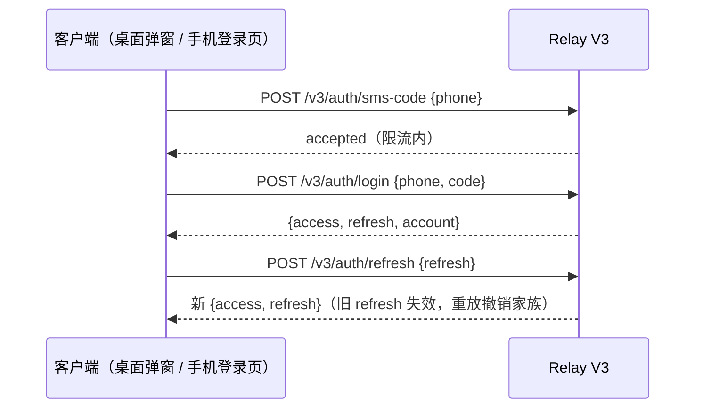
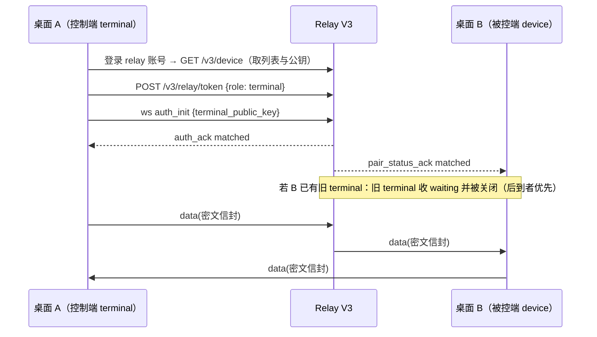

# Relay V3 自托管设计与架构

状态：设计稿（未实现）。本文是 Relay V3 的产品规则、协议契约、状态所有权与验收边界的 spec 源；实现前以此为准，实现后随行为变更同步更新。

V3 是全新协议，**不兼容现有闭源 Relay V2**，不与 V2 共存或灰度迁移：客户端（桌面 main、手机 Web、Android 壳）一次性切换到 V3，V2 transport 与其 OAuth 登录链路在客户端切换完成后移除。本文不承担 V2 兼容义务，契约设计只以 V3 自身需求为准；V2 文档（[Relay V2 共享契约与配对](../web-remote-control/relay-v2-pairing.md)）仅作语义参考。

## 1. 背景与目标

### 背景

当前手机远控使用外部共享 Relay（Relay V2），契约定义在闭源 zcode-server 仓库（见 [Relay V2 共享契约与配对](../web-remote-control/relay-v2-pairing.md)）。存在两个结构性问题：

1. **消息明文过 relay**。V2 的 `data.payload` 以明文 JSON 透传，relay（及其运维方）可见任务内容、权限请求等全部业务数据。
2. **服务端不可控**。relay 实现、部署、账号体系（OAuth）均在仓库外，无法自部署、无法演进协议。

OpenBitFun（`C:\Users\xufan\Trae\OpenBitFun`）证明了替代形态可行：relay 只转发端到端加密的密文，账号（手机号+短信验证码）由 relay 自有，设备目录（含公钥）供同账号对端取用，relay 全程不见明文。

### 目标

- 仓库内新增自托管 relay：TypeScript + Fastify，代码位于根目录 `relay-server/`。
- **一步到位引入端到端加密**：`data` 消息以 X25519 + HKDF-SHA256 + AES-256-GCM 加密，relay 只见密文。
- 登录改造为 relay 自有账号：手机号 + 短信验证码（Aliyun SMS），与桌面端模型供应商 OAuth 解耦。
- **桌面互控**：桌面 App 既能作为被控端（device），也能作为控制端（terminal）连接同账号的其他电脑，在桌面 UI 中浏览与操作目标设备的任务。
- 协议与客户端（桌面 main、手机 Web、Android 壳）的全部代码收敛到本仓库，契约可用同一套 fixture/一致性测试覆盖。
- 全新协议、无历史包袱：字段、端点、错误码按 V3 自身需求设计，不保留 V2 字段兼容层。

### 非目标（本期不做）

- 不改变业务所有权：relay 不保存 task、workspace、stream、已提交输入；桌面 `desktop-continuous` 与手机 `web-remote-replayable` 的 owner、snapshot/gap、host attachment、CommandInbox 边界全部不变。本项是纯 transport 层替换。
- 不做多实例水平扩展（单进程单写 SQLite，内存持有在线连接与配对 owner；扩容路径见 §10 开放问题）。
- 桌面互控不重写 Agent runtime：控制端桌面不启动独立 Host/Agent，只消费目标设备经 relay 同步的任务视图（边界详见 §6）。
- 不做手机原生 App（Android 壳继续承载 `/remote` Web 页面）。
- 不做前向保密（static-static ECDH 无 FS），算法字段预留升级位（§4.6）。
- 局域网直连模式不在本期，架构上不排除（relay 实现天然可嵌入）。

## 2. 总体架构

```text
手机浏览器（terminal，X25519 私钥本地）──┐
                                        │  同账号设备目录取对端公钥
桌面 App（控制端 terminal，§6）──────────┤
                                        ▼
              Relay V3（relay-server/，Fastify + ws + SQLite）
                职责：账号/短信、JWT、设备目录（含公钥）、配对、密文透传、限流
                                        │
                                        ▼
              目标桌面 main（device transport，X25519 私钥本地）
                └─ attachment 调度 → 目标窗口共享 Host 的 workspace scope → 同一 task runtime owner
                                        ^
              目标桌面 renderer（continuous）─┘
```

一台桌面可以同时具备两种角色：作为 **device**（被控端）接受手机/其他桌面的控制，作为 **terminal**（控制端）连接其他电脑；两个方向的连接、密钥与配对状态互相独立。

### 仓库布局

| 位置 | 内容 |
| --- | --- |
| `relay-server/` | 新增 pnpm workspace 包 `@zcode/relay-server`（需在 `pnpm-workspace.yaml` 的 `packages` 中追加 `relay-server`）。`src/`（auth、sms、devices、ws、limits、db、admin）、`tests/`、`Dockerfile`、`docker-compose.yml`（P3）。 |
| `packages/shared/src/remote-relay-v3/` | V3 协议类型、严格解析、信封编解码、加密模块（`crypto.ts`，基于 `@noble/curves` + `@noble/ciphers` + `@noble/hashes`，纯 JS，Node 与浏览器同一实现）；测试 fixture `fake-relay-v3` 以测试子路径导出，不进浏览器 bundle。 |
| `packages/desktop` main | device transport 升级 V3 + relay 账号登录。 |
| `packages/web` | `/remote/v4` 登录页改为手机号+验证码表单；terminal transport 升级 V3。 |
| `docs/relay-server/` | 本 spec 及后续验收记录。 |

### 所有权一览

| 状态 | 唯一 owner |
| --- | --- |
| 账号、短信验证码、refresh token 家族 | relay SQLite |
| 设备记录（MID/SID/公钥/在线态） | relay（在线态为内存事实，SQLite 存注册事实） |
| `(SID, role)` 当前连接 owner、一次性 ws token | relay 进程内存 |
| 控制端选中态（当前设备/任务，§6） | 控制端桌面本地（与被控端 renderer 选中态互不回写） |
| X25519 私钥 | 各端本地，永不出端（桌面存 main 进程；手机存页面会话内存） |
| 配对状态、消息加解密 | 各端 transport |
| 设备身份持久化（SID/账号/endpoint/私钥） | 桌面 AppSettings（新增 relay 账号与设备身份字段，私钥只落本地用户数据目录） |

## 3. 账号与登录

### 3.1 账号模型

- 账号 = 手机号（E.164，唯一）。首次验证码登录成功即建号（与 OpenBitFun 一致）；可后置设置密码作为短信不可用时的登录方式（`relay-admin set-password` 或登录后设置）。
- `RELAY_LOCAL_REGISTRATION=open|closed`：closed 时新手机号不可自注册，仅 `relay-admin add-user --phone <number>` 预建账号。
- 账号与桌面模型供应商账号（Z.AI/BigModel OAuth）**完全无关**。桌面远控弹窗新增 relay 登录区（手机号+验证码表单），不触碰 OAuth credential；`auth-required` 语义改为"远控等待 relay 账号登录"，复用现有 manager 状态机。

### 3.2 短信验证码

- 发送通道：Aliyun Dysmsapi，凭据来自 `RELAY_SMS_*` 环境变量。未配置时验证码接口返回 503（密码登录仍可用）——与 OpenBitFun 行为一致。
- 开发/测试通道：`RELAY_SMS_PROVIDER=test` 且非生产构建时，验证码不真正外发，仅返回给测试接缝；生产构建禁用 test provider，验证码不写日志。
- 验证码 6 位数字、5 分钟有效、单次使用；存储为加盐哈希。发送限流：每 IP 每分钟 5 条、60 秒重发冷却、每手机号每天 10 条。校验限流：每 IP 每分钟 10 次，连续失败按账号指数锁定（5 次失败锁 5 分钟起步）。

### 3.3 Token

- 登录/刷新签发 `{access_token, refresh_token}`：access 为 JWT（HS256，10 分钟，claims 仅 `sub`/`exp`/`iat`/`jti`）；refresh 为 32 字节随机串的哈希落库，30 天有效。
- refresh 旋转：每次刷新旧 token 失效并签发新 token，构成家族；**已旋转 token 的重放撤销整个家族**（防盗号续期）。登出撤销当前家族。
- `Authorization: Bearer <access>` 用于所有设备/目录接口；ws 一次性 token（60 秒、原子消费）契约见 §5.2。token 不进二维码、不写日志。

### 3.4 登录时序



## 4. 端到端加密

### 4.1 信任模型

- relay 负责**认证**（账号、设备目录、同账号隔离）与**可用性**（透传、配对），**不保证机密性**——密钥协商所需信息均为公钥，relay 无私钥不可解密。
- relay 可在目录响应中替换设备公钥从而实施 MITM，这与 OpenBitFun 的信任边界相同。缓解手段（本期不做，列为开放问题）：二维码携带设备公钥指纹短哈希，手机端显示比对（§10）。
- 密钥生成、派生、加解密全部在各端完成；relay 进程不引入任何加密依赖，`data` 信封对其为不透明字符串（仅校验长度与 JSON 结构）。

### 4.2 密钥生成与分发

- **桌面 device**：首次注册时本地生成 X25519 静态密钥对，注册请求携带公钥（base64url 32 字节）。私钥保存在 main 进程（持久化设备身份时一并持久化私钥，存于用户数据目录，不进同步设置）。重新注册即换新密钥对并产生新 SID——密钥轮换与设备轮换同生命周期。
- **terminal（手机浏览器或桌面控制端）**：每次控制会话生成一次性 X25519 密钥对，`auth_init` 携带 `terminal_public_key`（信封元数据，明文可见——它本来就是公钥）。手机页面关闭即弃；桌面控制端随控制连接生命周期，断开重连重新生成，不持久化。
- **公钥获取**：手机经认证的 `GET /v3/device` 取得目标设备的 `public_key`；桌面从 terminal 的 `auth_init` 取得 terminal 公钥。双方均可本地推导同一会话密钥，无需额外往返。

### 4.3 会话密钥派生

与 OpenBitFun `device_crypto.rs` 同构（已验证的方案，直接采纳）：

```text
shared   = X25519(本地私钥, 对端公钥)
info     = sort_bytes(本地公钥 ‖ 对端公钥)   ← 排序使推导对称，两端得同一 key
salt     = "ZCode Relay V3 device key v1"
key      = HKDF-SHA256(salt, shared, info)  → 32 字节 AES-256-GCM 密钥
```

- 校验对端公钥可贡献性（拒绝全零等退化点），失败按 `AUTH_FAILED` 处理。
- 密钥仅存内存，配对重建（断线重连、terminal 刷新、对端重注册）时重新派生。

### 4.4 消息加密

- 算法：AES-256-GCM，每条消息随机 12 字节 nonce；密文附 16 字节 GCM tag。明文为桌面 renderer 与手机页面交换的既有业务 JSON 序列化字节，业务层不感知加密。
- 单条 `data` 消息（含密文膨胀：nonce、GCM tag、信封字段）上限 1 MiB。

### 4.5 信封

V3 的 `data` 消息外层结构为 `{payload, client_ts}`（上行）/ `{payload, server_ts}`（下行），`payload` 为密文信封：

```json
{
  "v": 3,
  "alg": "x25519-hkdfsha256-aes256gcm-v1",
  "kid": "<设备密钥指纹，8 字节 hex>",
  "nonce": "<base64url 12 字节>",
  "ct": "<base64url 密文>"
}
```

- relay 只校验 `payload` 为合法 JSON 对象且总长在预算内，不解析字段。
- 接收端按 `alg` 分派；未知 `alg` 或解密失败计为协议错误（transport 记录 `decrypt-failed` 并断开重建，不静默丢弃）。
- `kid` 用于多密钥共存（重注册窗口期旧消息到达），首版即携带，避免后续加字段。

### 4.6 已知限制

- static-static ECDH 无前向保密：设备静态私钥泄露可解密其参与过协商的会话（会话密钥仅存内存，terminal 侧随页面消亡；桌面侧风险与设备本身失陷等同）。`alg` 字段为后续 ephemeral 握手预留升级位。
- 手机公钥经 `auth_init` 明文传递，依赖 relay 认证保证其归属真实终端会话；伪造 terminal 公钥只能导致密钥协商失败（攻击者无私钥无法完成 ECDH 对端推导），不构成机密性破坏。

## 5. Relay V3 协议契约

所有接口前缀 `/v3`，成功信封 `{code: 0, msg: string, data: T}`，失败信封 `{code: 非零整数, msg: string, data?: null}`；HTTP 非 2xx 可能无 JSON 正文，调用方必须同时检查 HTTP 状态与业务 `code`。

### 5.1 HTTP| 方法与路径 | 认证 | 请求 | 成功 data |
| --- | --- | --- | --- |
| `POST /v3/auth/sms-code` | 无 | `{phone: E.164}` | `null` |
| `POST /v3/auth/login` | 无 | `{phone, code}` 或 `{phone, password}` | `{access, refresh, account: {id, phone_masked}}` |
| `POST /v3/auth/refresh` | 无 | `{refresh}` | 新 `{access, refresh}` |
| `POST /v3/auth/logout` | Bearer | 无 | `null` |
| `POST /v3/device` | Bearer | `{device_mid: ≤128字符, public_key: base64url 32B}` | 设备记录 |
| `GET /v3/device` | Bearer | 无 | 当前账号设备记录数组 |
| `POST /v3/device/delete` | Bearer | `{device_sid}` | `null`（仅离线设备可删、删除幂等、越权返回 `no permission`） |
| `POST /v3/relay/token` | Bearer | `{role: "device" \| "terminal"}` | `{token, expires_in: 60}` |

设备记录：`{device_sid, device_mid, public_key, online, created_at, meta: {name?, platform?, version?}}`。注册不接收 `meta` 与 `online`；同 MID 每次注册产生新 SID 与新公钥绑定。

### 5.2 WebSocket

入口 `/v3/relay/ws?token=...`（一次性 token：16 字节随机、22 字符 Base64URL、绑定账号与角色、60 秒有效、Upgrade 前原子消费、失败不恢复，过期不影响已建立的连接）。

心跳与超时：客户端每 4~6 秒（基准 5,000ms，±1,000ms 随机）发送 `pair_status_query` 或心跳，ACK deadline 15s，watchdog 独立计时；握手（auth_init → auth_ack）有 15s deadline。

| 方向 | 消息 | 字段 |
| --- | --- | --- |
| 客户端 → relay | `auth_init` | device：`device_sid`（≤128 UTF-8 字节）、可选 `meta`、可选 `client_ts`（Unix 秒）；terminal：`terminal_public_key`（base64url 32 字节，必填）、可选 `client_ts` |
| 客户端 → relay | `pair_status_query` | 可选 `client_ts` |
| 客户端 → relay | `data` | 必填 `payload`（密文信封，§4.5）、可选 `client_ts` |
| relay → 客户端 | `auth_ack` | `device_sid`、`terminal_sid`、`pair_status`、可选 `server_ts` |
| relay → 客户端 | `pair_status_ack` | `terminal_sid`、`pair_status`、可选 `server_ts` |
| relay → 客户端 | `data` | `payload`、可选 `server_ts` |
| relay → 客户端 | `error` | `code`、可选 `message`、可选 `server_ts` |

`terminal_sid` 允许空字符串或缺省：device 的 auth ACK 为空，terminal 的 auth ACK 是分配的 SID；查询 ACK 是对端 terminal SID，推送 ACK 为空。`pair_status` 仅 `waiting | matched`。错误码仅 `AUTH_FAILED | WRONG_PARAM | KICKED | INTERNAL | DEVICE_OFFLINE`。时间戳为非负整数 Unix 秒，不参与授权。

配对 owner 语义（纳入一致性测试）：relay 是设备、一次性 token、连接与 `(SID, role)` 当前 owner 的唯一事实源。先验证归属，再替换同角色旧 owner、发送 `KICKED` 并关闭旧连接；旧连接异步 close 不得移除新 owner。未认证不能发 data/query，重复认证或非法字段关闭连接。设备断开时通知 terminal `waiting`、`DEVICE_OFFLINE` 并关闭；terminal 断开仅通知 device `waiting`。数据只发给同 SID 的另一角色，relay 不读取、不解析 payload 内容（仅校验为合法 JSON 对象且长度在预算内）。

terminal 角色不区分客户端类型：手机浏览器与桌面控制端（§6）使用完全相同的 terminal 协议。**同一设备同时最多一个 active terminal**：新 terminal 配对成功后，设备侧解除旧 terminal 的配对（旧 terminal 收到 `waiting` 并被关闭，语义同设备离线通知）；后到者优先，避免被控端维护多份会话密钥与扇出。多 terminal 并发列于 §10 开放问题。

### 5.3 二维码与页面入口

- 二维码参数集为 `sid`、`mid`、`name`、`app_version`（均为可选路由提示），base URL 指向 relay 自带的静态页面（§5.4）；解析函数拒绝未知参数与带凭据的链接。
- 手机登录页为手机号+验证码表单（复用现有登录卡片页头规格）；无跨域 OAuth 回跳，`appReturnTo`、nonce/CSRF 机制不需要（登录即本站请求，CSRF 由同源 + JSON body + 限流覆盖，刷新 token 重放防护见 §3.3）。

### 5.4 静态资源

relay 通过 `RELAY_STATIC_DIR` 指向 `/remote/v4` 手机页面静态产物目录，使自部署实例"扫码即用"。未配置该目录时二维码生成入口在桌面侧提示不可用；生产部署建议始终配置，并由反向代理直接缓存静态资源。

## 6. 桌面互控（desktop ↔ desktop）

### 6.1 角色与入口

- 桌面控制端就是一个 terminal，复用 §5.2 的 terminal 协议、一次性 token、配对与加密栈；relay 与被控端不感知控制端是手机还是桌面。
- 入口不扫码：桌面控制端登录 relay 账号后，经认证的 `GET /v3/device` 列出同账号设备，选择在线目标设备 → `POST /v3/relay/token {role: "terminal"}` → WS 配对（§5.2），每一步与手机 terminal 相同。
- 一台桌面可同时持有两种角色：本地 renderer 的 `desktop-continuous` 主链路（作为被控端被手机/其他桌面控制）与自身作为控制端的 replayable 链路互相独立，两个方向的连接、密钥、配对状态、退避互不干扰。

### 6.2 能力边界（第一版）

- 控制端可：浏览目标设备已有工作区与任务、打开会话、发送输入、新建任务、处理权限与交互请求——与手机 terminal 能力对齐。
- 控制端不可：启动独立 Host/Agent/runtime（任务一律在目标设备执行，控制端不落地业务状态）；新建 SSH/WSL/Docker 连接或管理目标设备的工作区连接（与手机边界一致；目标设备断开的远程工作区由被控端自身重连，控制端只展示状态）。
- UI 第一版范围：设备切换器 + 任务首页 + 会话聊天页（宽屏布局）。文件管理器、终端直连等更重的表面经 attachment capability 约束默认关闭，后续版本评估。

### 6.3 同步语义

- 控制端的任务同步**复用 `web-remote-replayable` 语义**：控制端 main 承载与手机等价的 replayable attachment（快照对齐、gap 恢复、断线重放），不新增第三种链路语义；`desktop-continuous` 仍只属于被控端本地 renderer。
- 控制端选中态（当前设备、当前任务）是控制端本地状态，不影响被控端 renderer 的选中态；被控端 renderer 也不感知控制端操作（与手机远控一致）。
- 输入 admission、权限请求的 owner 仍在目标设备 runtime（`CommandInbox` 串行 admission、host attachment 路由、stale run 防护全部不变）；控制端只投递输入与消费事件。

### 6.4 时序



### 6.5 验收

- 桌面 A 控制桌面 B：同账号选设备、配对、密文会话收发、任务首页与手机一致；B 断开 relay 时 A 显示设备离线并停止输入入口。
- 双向并发：A 被 C（手机）控制的同时作为控制端控制 B，两条链路互不干扰（A 的本地 renderer 不受 A 控制端角色影响）。
- 后到者优先：B 已与手机配对时 A 发起控制，手机侧收到断开并可重新配对；A 断开后 B 恢复 waiting。
- 控制端断线重连按 replayable 语义恢复，刷新选中态不串到被控端。

## 7. 数据模型（SQLite，`node:sqlite`，WAL）

| 表 | 关键列 |
| --- | --- |
| `accounts` | `id`、`phone_e164`（唯一）、`password_scrypt?`、`status`、`created_at` |
| `sms_codes` | `phone`、`code_hash`、`purpose`、`expires_at`、`used`、`request_ip`、`created_at`（TTL 清理任务） |
| `devices` | `sid`（主键）、`account_id`、`device_mid`、`public_key`、`meta`、`created_at`、`deleted_at` |
| `refresh_tokens` | `token_hash`、`family_id`、`account_id`、`expires_at`、`rotated_from`、`revoked_at` |

在线态、配对 owner、一次性 token 均为进程内存事实，不入库；进程重启后设备显示离线，客户端按既有退避重连，无需恢复逻辑。数据库路径 `RELAY_DB_PATH` 必填，缺失则启动失败（fail closed，沿用 OpenBitFun 约束）。

## 8. 资源限额与部署

限额为编译期常量（对齐 OpenBitFun 思路，规模按自部署下调）：

| 资源 | 限额 |
| --- | --- |
| 鉴权请求体 | 16 KiB，超限 413 |
| 并发 HTTP 请求 | 512，超限 503 |
| 验证码发送 / 登录尝试 | §3.2 限流表 |
| refresh 旋转 | 30/分钟/IP；重放撤销家族 |
| WS 连接 | 256/进程；握手 15s deadline；ping 5s±1s / pong 45s 超时 |
| WS 单消息 | 1 MiB（含密文膨胀预算） |
| WS 出站队列 | 128 条/连接；2s 内无法入队即丢弃该帧 |
| 设备数 / 活跃凭据 | 64 / 256 每账号，数据库原子准入 |
| 密文单条 | 4 MiB 上限（含信封），超限 413 |

部署（P3）：Dockerfile 多阶段构建 + docker-compose + 反向代理样例（Caddy）；仅暴露 TLS 入口；`RELAY_PORT`/`RELAY_DB_PATH`/`RELAY_STATIC_DIR`/`RELAY_SMS_*`/`RELAY_LOCAL_REGISTRATION`/`RELAY_JWT_SECRET` 为配置面。`relay-admin` CLI：`list-users`、`add-user --phone --password-stdin`、`delete-user --phone`、`set-password --phone --password-stdin`、`list-devices --phone`。

## 9. 实施里程碑

加密逻辑全部位于客户端；relay 对密文无感知，因此 relay 可一次交付完整版（P0 即含公钥字段与信封透传）。各里程碑之间无兼容性过渡：V3 客户端只连 V3 relay。

### P0 relay-server 完整实现

- Fastify + `ws` + `node:sqlite`，§3/§5/§7/§8 全量落地；加密无关，无需加密依赖。
- 一致性测试：新建 `fake-relay-v3` fixture（参照现有 `fake-relay-v2` 的测试接缝模式：真实 loopback HTTP/WS、注入故障、调用/消息留存），并以同一套用例回放真实 relay——fixture 与真实实现共用验收矩阵，杜绝两套行为。
- 验收：fixture/真实 relay 双跑全绿；限流、refresh 家族撤销、fail-closed 启动、`relay-admin` 流程有测试；`pnpm typecheck`/`pnpm lint` 通过；`pnpm-workspace.yaml`、typecheck 工程引用、lint 范围纳入 relay-server。

### P1 桌面 device V3

- main：relay 账号登录（弹窗手机号+验证码表单）、设备注册携带公钥、私钥持久化、transport V3（加密信封收发、解密失败断开重建、重连先关旧连再取新 token）。
- AppSettings 新增 relay 账号与设备身份字段；`auth-required`/`error` 状态语义映射遵循现有 manager 状态机。
- 验收：桌面 E2E 覆盖登录→注册→配对→密文收发→登出清理；私钥不进日志、不进设置同步。

### P2 手机 Web + Android 壳

- `/remote/v4` 登录页改手机号+验证码；terminal 生成一次性密钥、`auth_init` 携带公钥、data 加解密。
- Android 壳 URL 策略：生产包放行 V3 relay origin（构建期注入）。
- 验收：390px/1024px × 深浅主题 × 中英文登录/设备列表/聊天回归；真机密文链路联调；relay serve 静态页面的自部署"扫码即用"验证。

### P3 部署与客户端收口

- Docker/compose/TLS、staging 真机联调、生产 V3 实例上线。
- 客户端全面切至 V3 后，移除桌面与手机 Web 的 V2 transport、OAuth 远控登录链路（`web-remote-login.md` 的回跳机制、`fake-relay-v2` 的生产引用），相关文档归档。

### P4 桌面互控

- 控制端 terminal transport（复用 P1 的 V3 加密栈与状态机，新增"作为控制端连接目标设备"的启动/停止/状态机实例）、设备切换器 UI、任务首页与会话页宽屏布局（§6.2 范围）。
- 被控端无 relay 侧改动（terminal 协议已泛化），仅需验证单 active terminal 替换语义与被控端多来源（手机 + 桌面）配对切换。
- 验收：§6.5 全部场景；控制端与被控端 `desktop-continuous` / replayable 双语义回归；架构检查确认控制端不新增跨域导入（控制端 main 复用现有 attachment/bridge 路径，不经 renderer 直连）。

## 10. 开放问题

1. **公钥替换 MITM**：是否在二维码中加入设备公钥指纹、手机端显示比对？增加 UX 成本，OpenBitFun 未做；建议 P2 真机验证后决定。
2. **短信成本**：自部署者需自备 Aliyun 凭据；closed-registration + `relay-admin` 预建账号是默认兜底，是否够用待观察。
3. **桌面 relay 账号与 OAuth 账号并存**的设置页信息架构（两个"登录"概念需要 UI 区分），P1 前与设计对齐。
4. **多实例扩展**：单进程假设（内存 owner）上限约 256 连接；若需扩容，路径是把 owner/token 迁到 Redis 并引入 sticky 路由，本期不做、接口设计不预设阻碍。
5. **JWT 算法**：单实例 HS256 + 环境变量密钥已够；若未来多实例，换 EdDSA 并公钥化校验。
6. **多 terminal 并发**：第一版单 active terminal（后到者优先，§5.2）。家庭/团队"多人同时看一台电脑"需要设备侧维护多份会话密钥与扇出广播，涉及被控端 transport 较大改动；若 P4 后有真实需求再立项。

## 11. 风险登记

| 风险 | 缓解 |
| --- | --- |
| V3 契约在设计期就写死，真机联调暴露字段错误 | fixture 与真实 relay 共用一致性矩阵；P1 起用假 relay 先行开发，P3 真机收口 |
| 客户端两端（桌面/手机）协议版本漂移 | 信封 `v`/`alg` 严格校验，未知值按协议错误断开；两端共享同一 shared 协议模块与 fixture，不各自手写编解码 |
| 私钥持久化位置不当（进同步/进日志） | 仅存 main 进程用户数据目录；回归测试断言不出现在设置同步与日志（含 `debug` 级） |
| 限流缺失导致自部署实例被刷 | §8 限额为编译期常量，P0 即带测试；部署文档强制反代 TLS |
