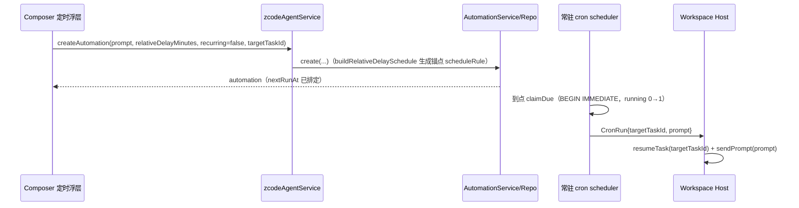

# Composer 定时发送

## 目标与范围

在 v4 composer 发送键右侧增加下拉入口「设为定时」，把当前草稿正文按用户选择的时间点投递，而不是立即发送。本期只实现「设为定时」，不实现参考图中的「设为静音」「锁定发送」。

定时发送不是新的调度系统，而是复用已有 automation 基础设施：一次定时发送 = 一条一次性（`recurring=false`）automation，到点由常驻 scheduler 派发回原会话。

## 状态所有者

- 预设时间点：唯一所有者是 UI 本地偏好（`scheduledSendPresetStore`，localStorage 持久化，键空间独立）。不写入 tasks-index，不进协议参数。label 由 i18n 依据预设模型生成，不存文案字符串。
- 定时事实：唯一所有者是 tasks-index 的 `automations` 表（`AutomationRepo`）。UI 不维护第二份「待发队列」；管理页与「定时任务」分组直接读同一列表。
- 派发与结算：常驻 scheduler 进程 + Host 域，与手动/普通 cron 任务共用同一条 `CronRun` / `CronRunResult` 链路，不新增入口。

## 行为契约

- 入口只在本地 workspace 出现：`remoteAvailable` 为真且 `workspaceIdentity` 非远程（空 identity 视为本地，非空时用 `!isRemoteWorkspaceIdentity` 判定；远程 workspace 由手机/远控页面复用现有会话，V1 不提供定时入口）。运行中（Stop 态）、`canSend` 为假、runtime 未就绪时禁用。
- 「设为定时」读取当前草稿纯文本；正文为空不提交。草稿含附件、代码批注、网页元素、画板/会话引用等非文本上下文时禁用入口（tooltip 说明定时发送暂只支持纯文本）。
- 时间选择浮层：
  - 预设列表：点击选中，展示换算后的绝对时间（如「今晚 20:00 · 约 3 小时后」）。默认预设：10 分钟后、30 分钟后、1 小时后、今晚 20:00、明早 09:00。
  - 自定义时间：日期 + 时:分组合，解析为本地时区目标时刻。
  - 管理预设：可增删预设（类型 = 相对偏移 N 分钟/小时/天，或每日 HH:mm 时刻）与恢复默认；上限 10 条。
- 确认后：
  - 确认时按当前时刻重算目标时刻（浮层预览仅作展示），重算后落在过去或超界按非法提示，不提交。
  - 目标时刻换算为 `relativeDelayMinutes = max(1, round((target-now)/60000))`，超过 525600（约一年）判为非法并提示，不提交。
  - 以 `recurring=false`、当前 composer 的 `modelSelection`/`mode`、`workspacePath`/`workspaceIdentity` 调 `createAutomation`；已有会话时带 `targetTaskId=sessionId`，草稿态（无 sessionId）不带 `targetTaskId`，到点走既有 fallback 新建会话派发。
  - 成功：清空草稿（复用发送后的草稿清理路径），toast「已设为定时发送 · <绝对时间>」，后台刷新对应 workspace 的 automation 列表。
  - 失败：命中 `AUTOMATION_CREATE_LIMIT` 给出上限 toast；其余给通用失败 toast，均不清空草稿。
- 时间精度为分钟级：沿用 `buildRelativeDelaySchedule` 的创建时刻锚点，秒级偏差 ≤30s，与 CLI 会话内定时任务一致。
- 到点派发依赖本地 desktop 运行时；应用未运行期间按既有 misfire 策略处理（错过窗口标记 skipped），本期不新增补偿或唤醒。

## 验收场景

1. 已有会话输入正文 → 选「1 小时后」→ 确认 → 草稿清空、toast 出现、automation 列表新增一条一次性任务，`nextRunAt` 约为 1 小时后。
2. 自定义日期时间 → 目标时刻换算正确；选过去时间时入口不可提交或提示非法。
3. 管理预设中删除「今晚 20:00」并新增「每天 12:00」→ 重启后 localStorage 恢复该集合。
4. 草稿含图片附件 → 「设为定时」禁用并给出原因提示。
5. automation 数量已达上限 → 确认后 toast 上限、草稿保留。
6. 远程 workspace / 运行中 / 空正文 → 下拉触发键隐藏或禁用，不产生 automation。
7. 到点：绑定会话的任务经 `CronRun{targetTaskId}` `resumeTask`+`sendPrompt` 注入原会话；草稿态任务 fallback 新建会话。

## 验证

执行 `pnpm typecheck`、`pnpm lint`、`pnpm architecture:check --changed` 与新增/受影响 UT（预设 store、时间换算 helper、组件确认回调、services 透传）。E2E 覆盖「输入草稿 → 打开定时菜单 → 选预设 → 确认 → 草稿清空且 automation 出现」；到点注入依赖真实 scheduler，作为手动/后续推广场景验证，不阻塞本实现。无法自动覆盖的运行时派发在提交说明中如实标注。
