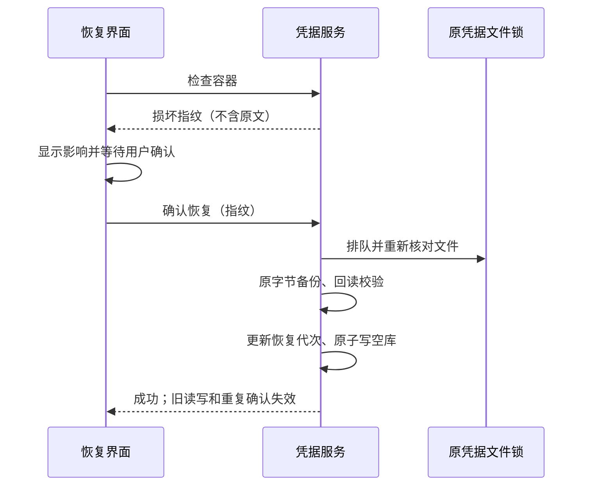

# 凭据容器损坏恢复

状态：已实现。本文从原 `docs/ui/login-page.md` 拆出：relay 账号成为应用登录后，凭据容器恢复不再属于登录页，但语义与所有权不变（见 [relay-login.md](./relay-login.md)）。

Host 确认 `credentials.json` 整体 JSON、UTF-8 或顶层 string record 无效时，提供「恢复凭据存储」入口。正常库、缺失文件、单条密文解密错误、权限和普通 IO 错误不进入此流程。提示明确说明 OAuth、手填 API Key、Bot、MCP、远控等凭据需要重新配置。打开入口不修改原文件；确认框取消仍保留原始字节。

确认提交由 `ICredentialService` 唯一处理：在原有跨进程文件锁内，重新读取并核对用户看到的损坏指纹，确认仍损坏，备份原始字节并回读核验完整性，确定性备份已存在但字节不同时，保留旧备份并另建独立备份，回读核验后才继续；随后推进恢复代次并原子写入空库。备份/代次/写入失败不得删除原件。指纹改变或库已有效时拒绝旧确认，重新检查状态；重复点击不得再次清空已恢复或新保存的库。

`credentials.json.recovery-generation` 只保存随机恢复代次，不保存凭据。普通读取不取得写锁，在 IO 前后核对代次；写入在请求进入时读取代次，取得同一文件锁后再核对。恢复推进代次后、空库替换前，原件仍是已经确认损坏的内容，读取必须严格解析并拒绝，不能当作有效会话。所有写入继续在同一文件锁内执行。旧请求失败，不得返回旧会话或把旧值写入新空库。正常并发保存沿用原有锁内合并语义。恢复代次先于空库替换持久化；替换失败时可以重新检查并确认，但旧请求仍作废。

完成恢复后显示已保存备份及「重新加载」按钮，由用户主动重新加载，不自动登录、不自动填回备份、不触发更新安装。界面共用主题、国际化和响应式组件。此恢复入口只允许本机 Desktop；手机的 Credential RPC 只保留普通 load/save/delete，拒绝 inspectStore/recoverStore，UI 不显示恢复入口或本机备份路径。手机/shared-host 在凭据不可读时不能建立可信的工作区连接，应先在电脑端恢复；不得绕过配对鉴权暴露重置入口，也不另建手机凭据库或 runtime。

整库检查与恢复只允许本机 Desktop 的 local MessagePort attachment，不能从任何网络 RPC 调用。ServiceCollection 发布凭据频道时默认拒绝 inspectStore/recoverStore，只有 Host 为本机桌面显式给出 local-desktop 恢复策略才保留这两个方法。Web Server、Source Server Core 的 `/ws`、`/ws/host`、兼容远端 stdio，以及手机和远端/source-settings attachment 均只保留普通 load/save/delete；拒绝恢复时返回 `feature_disabled`，不返回损坏指纹或备份路径、不改变原文件或恢复代次。连接的 continuous/replayable 模式仍按原合同工作，不能作为整库恢复的授权依据。

票据签发、过期和一次性消费沿用现有连接合同，本次不把票据当作数据恢复授权。Main 为手机 attachment 固定注入 replayable 模式；本机恢复策略不从客户端 RPC 参数读取。Source settings 只代理远端服务，不能借本机进程重新获得远端恢复权限。
