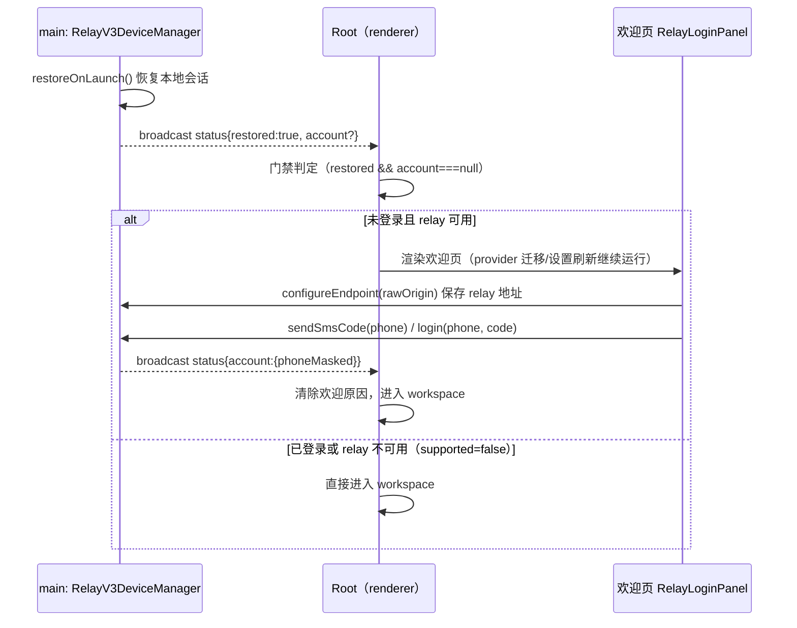

# Relay 账号登录（桌面端应用登录）

状态：已实现。本文是桌面应用级登录的契约源，替换原 `docs/ui/login-page.md` 中 OAuth / API Key 登录部分；凭据容器损坏恢复见 [credential-store-recovery.md](./credential-store-recovery.md)，relay 协议与远控语义见 [relay-v3-design.md](../relay-server/relay-v3-design.md)。

## 1. 决策与边界

- 桌面应用级登录从 Z.AI / BigModel OAuth 改为 **relay v3 自有账号**（手机号 + 短信验证码）。欢迎页与侧边栏账号菜单里的 relay 登录入口保留（触发按钮文案为「设置」），内容改为 relay 登录。
- relay 账号只提供 `{account.id, phone_masked}`，与 OAuth `UserInfo`、ZCode JWT、套餐/团队、模型凭证无关。原依赖 OAuth 用户身份的语音输入、Coding Plan 套餐/升级、用量摘要、插件区域、onboarding 身份一律去账号化：改为匿名或基于本地 provider 配置；这些能力降级是可接受的产品后果。
- 模型凭证不在欢迎页填写：用户在设置页用 fork 自有的「连接派 / linkpi」模板（`config/provider/zcode-builtin.json` 的 `forkTemplateIds`）填自己的 API Key 并拉取模型。未配置模型时沿用 `modelConfigMissing` 横幅；**provider 可用性不再作为登录门禁**。
- `packages/services/src/oauth/**` 与 CLI 登录保留：它们服务 provider 运行时、Coding Plan webview 与 CLI，不属于桌面应用登录。

## 2. 状态所有权与事件顺序

relay 会话的唯一 owner 是桌面 main 的 `RelayV3AccountService` / `RelayV3DeviceManager`；access/refresh token 与设备私钥不进 renderer。renderer 只通过 `useRelayV3RemoteControl`（底层 `IPlatformService`）读投影、发命令。

- 门禁条件：`status !== null && status.restored && status.account === null`。`phase: "idle"` 无法区分首次安装、已登出与恢复前状态，**不得**用 phase 判断登录。
- `restored` 由 main 在 `restoreOnLaunch()` 的 `finally` 中置 true 并广播；失败、无会话、有会话三条路径都必须广播，renderer 不会永久 loading。
- relay 不可用（Web 或缺少 preload bridge，`supported === false`）直接跳过门禁，不弹欢迎页。
- `status === null`（首次查询未返回）期间只保持短暂启动 loading；查询失败即结束等待，不放宽为“已登录”。
- 欢迎页打开时必须抑制启动 loading，避免黑屏；`notifyRendererReady()` 在 Root 独立 effect 中无条件调用，不得放到 relay 门禁之后，否则桌面 deep-link 握手丢失。
- 登录成功后 Root 刷新 app settings 与 provider 状态，再关闭欢迎页；promise 失败仍关闭，避免卡死。

## 3. 欢迎页表单契约

- 复用 `useRelayV3RemoteControl` 与设置节 `RemoteControlSettingsSection.tsx` 的 relay 账号表单语义：服务器地址、手机号、验证码、发送/重发（60 秒 renderer 本地冷却）、登录、错误提示、已登录态（脱敏手机号）。
- 桌面不内置 relay 地址。地址草稿与 `status.relayOrigin` 不一致时，发送验证码与登录都必须被「先保存地址」门禁拦截，不得把草稿直接传给命令；保存不同地址会登出并重置设备身份（设计 §3.5）。
- 密码登录、设备授权批准、远控启动/停止、二维码与控制端设备列表仍只在设置页；欢迎页不承载这些高级流程。
- 视觉沿用全屏外壳（`ThemeHeroVisual` + `DesktopOverlayWindowControls` + 品牌卡片），满足 `DESIGN.md` 全屏覆盖层窗控可达规则；原 Z.AI 协议/隐私链接删除，保留版权行。

## 4. 401 / 会话失效

宿主侧 401 仍清理 relay 凭据并广播 `signed-out`；renderer 不再弹「登录已过期」重新登录提示，也不重启应用。用户看到普通聊天错误横幅；若需要重新登录，从侧边栏账号菜单或设置页主动进入。

## 5. 验收场景

1. 全新 profile（无 relay 账号、无地址）：启动后显示 relay 欢迎页；未保存地址时点发送验证码被拦截并提示先保存。
2. 保存合法 relay 地址 → 发送验证码 → 输入正确验证码登录 → 自动进入工作区，侧边栏显示脱敏手机号。
3. 已保存 relay 会话的 profile 重启：门禁等待 `restored`，不误弹欢迎页，直接进入工作区。
4. relay bridge 不可用（Web/无平台能力）：不弹欢迎页，工作区正常渲染。
5. 未配置 linkpi provider 时进入工作区：composer 显示 `modelConfigMissing` 横幅；设置页选「连接派」填 API Key 并拉取模型后横幅消失。
6. 已登录时从侧边栏账号菜单再次打开 relay 登录入口：欢迎页立即关闭并回到原界面，不新建 workspace。
7. 欢迎页在浅色/深色、中/英、窄屏下无横向溢出，最小化/最大化/关闭按钮可达。
